# ACADEMIC PROJECT REPORT

---

# **Design, Kinematic Modeling, Simulation, and Autonomous Navigation of the AgileX Scout Mini 4WD AMR in ROS 2 Jazzy**

---

## 📌 **Student & Course Credentials**

| Parameter | Details |
| :--- | :--- |
| **Subject Name** | Robot Operating system (ros) |
| **Subject Code** | **RA23E01** |
| **Student Name** | **Sailakshmi BT** |
| **Roll Number** | **2024511019** |
| **Robot Model** | **AgileX Scout Mini 4WD Autonomous Mobile Robot (AMR)** |
| **Operating System** | Ubuntu 24.04 LTS (Noble Numbat) |
| **Middleware & ROS Distribution** | ROS 2 Jazzy Jalisco (`/opt/ros/jazzy`) |
| **Physics Simulation Engine** | Gazebo Harmonic (`gz-sim8` via `ros_gz_bridge`) |
| **Visualization Platform** | RViz2 |
| **Date of Submission** | August 20, 2026 |

---

## 📑 **Table of Contents**
1. [Abstract & Objectives](#1-abstract--objectives)
2. [Robot Specifications & Mathematical Kinematics](#2-robot-specifications--mathematical-kinematics)
3. [Mechanical Design & SolidWorks Modeling Pipeline](#3-mechanical-design--solidworks-modeling-pipeline)
   - 3.1 SolidWorks CAD Assembly & Component Architecture
   - 3.2 Mass Properties & Inertial Matrix Calculation
   - 3.3 Coordinate Frames, Mates, and SolidWorks-to-URDF Export
4. [ROS 2 Package Architecture & URDF Model Hardening](#4-ros-2-package-architecture--urdf-model-hardening)
5. [Physics Engine & Simulation in Gazebo Harmonic](#5-physics-engine--simulation-in-gazebo-harmonic)
6. [Multi-Modal Perception Sensor Suite Integration](#6-multi-modal-perception-sensor-suite-integration)
7. [State Estimation & Sensor Fusion via Extended Kalman Filter (EKF)](#7-state-estimation--sensor-fusion-via-extended-kalman-filter-ekf)
8. [Simultaneous Localization and Mapping (SLAM)](#8-simultaneous-localization-and-mapping-slam)
9. [Autonomous Navigation Stack (Nav2) Implementation](#9-autonomous-navigation-stack-nav2-implementation)
10. [Autonomous Multi-Station Waypoint Patrol Missions (Arena & Civil Facility)](#10-autonomous-multi-station-waypoint-patrol-missions-arena--civil-facility)
11. [Step-by-Step Execution, Results & Verification Log](#11-step-by-step-execution-results--verification-log)
   - 11.1 Stage 1: Workspace Build & Simulation Launch Verification
   - 11.2 Stage 2: ROS 2 Topic Graph & TF Kinematic Tree Verification
   - 11.3 Stage 3: Perception Sensor Streaming (2D LiDAR & 3D RGB-D Depth)
   - 11.4 Stage 4: 2D SLAM Mapping & Metric Occupancy Grid Generation
   - 11.5 Stage 5: Nav2 Autonomous Navigation & Multi-Station Waypoint Patrol
   - 11.6 Stage 6: Civil Architectural Multi-Room Facility (20m x 16m) Simulation
   - 11.7 Stage 7: Real-Time 2D SLAM & Drift-Free EKF Odometry Trajectory Tracing
   - 11.8 Stage 8: AgileX Scout Mini Civil Floor Ground Station & Live Telemetry
12. [Engineering Challenges, Root-Cause Analysis & Solutions](#12-engineering-challenges-root-cause-analysis--solutions)
13. [Conclusion & Future Work](#13-conclusion--future-work)
14. [References & Code Repository](#14-references--code-repository)

---

## 1. Abstract & Objectives

### 1.1 Abstract
This project presents an end-to-end robotic systems engineering implementation of the **AgileX Scout Mini 4-Wheel Drive (4WD) Autonomous Mobile Robot (AMR)**. Beginning from 3D parametric CAD modeling in SolidWorks, the robot was exported into a Unified Robot Description Format (URDF) compliant with ROS REP-103 standards. The complete system was simulated in **Gazebo Harmonic (`gz-sim8`)** under **ROS 2 Jazzy Jalisco** on Ubuntu 24.04 LTS.

A multi-sensor perception pipeline (2D LiDAR, 6-Axis IMU, and RGB-D Depth Camera) was integrated to support real-time environmental awareness. An Extended Kalman Filter (`robot_localization`) was deployed to eliminate skid-steer odometry drift. The system demonstrates **SLAM 2D Occupancy Grid Mapping (`slam_toolbox`)** and **Full Autonomous Navigation (`Nav2`)** utilizing 3D Voxel Costmap raytracing, dynamic local obstacle evasion, and a multi-station autonomous patrol mission.

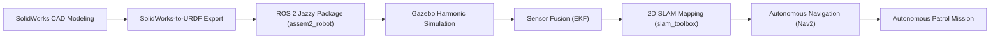

### 1.2 Key Objectives
1. Design and assemble the AgileX Scout Mini mechanical chassis and 4-wheel drive train in SolidWorks.
2. Formulate the skid-steer kinematic equations and establish the coordinate frame hierarchy adhering to ROS REP-103 ($+X$ Forward, $+Y$ Left, $+Z$ Up).
3. Export and calibrate the URDF with accurate mass, inertia tensors, analytical collision geometries, and joint dynamics.
4. Establish bidirectional ROS 2 Jazzy – Gazebo Harmonic communication via `ros_gz_bridge`.
5. Integrate multi-modal perception: 2D LiDAR (`/scan`), 6-Axis IMU (`/imu`), and RGB-D camera (`/camera/points`).
6. Implement an Extended Kalman Filter (EKF) for fused, drift-free odometry (`/odometry/filtered`).
7. Perform metric SLAM to produce high-fidelity occupancy grid maps.
8. Configure Nav2 with AMCL localization, global/local costmaps, DWB local path planning, and autonomous multi-goal waypoint navigation.

---

## 2. Robot Specifications & Mathematical Kinematics

### 2.1 Mechanical & Physical Specifications

| Parameter | Value / Specification |
| :--- | :--- |
| **Chassis Dimensions ($L \times W \times H$)** | $612\text{ mm} \times 580\text{ mm} \times 245\text{ mm}$ |
| **Track Width (Wheel Separation $d$)** | $0.612\text{ m}$ ($612\text{ mm}$) |
| **Wheelbase ($2l$)** | $0.390\text{ m}$ ($390\text{ mm}$) |
| **Wheel Radius ($r$)** | $0.080\text{ m}$ ($80\text{ mm}$) |
| **Chassis Mass ($m_b$)** | $22.0\text{ kg}$ |
| **Wheel Mass ($m_w$, each)** | $1.5\text{ kg}$ ($\times 4 = 6.0\text{ kg}$) |
| **Total Robot Mass ($M$)** | $28.0\text{ kg}$ |
| **Drive Configuration** | 4-Wheel Skid-Steer / Differential Drive |
| **Maximum Linear Velocity ($v_{max}$)** | $2.0\text{ m/s}$ |
| **Maximum Angular Velocity ($\omega_{max}$)** | $3.0\text{ rad/s}$ |

---

### 2.2 Mathematical Modeling: 4WD Skid-Steer Kinematics

The AgileX Scout Mini utilizes 4-wheel skid-steer kinematics. During turning, lateral tire slip occurs naturally. In idealized differential-drive equivalence with effective track width $d_{eff} = 0.612\text{ m}$ and wheel radius $r = 0.08\text{ m}$:

```
        [FRONT (+X)]
   (w1) Left       Right (w3)
    ┌───┐            ┌───┐
    │   │ ────────── │   │
    └───┘            └───┘
      │   d = 0.612m   │
      │        ▲       │
      │        │+Y     │
    ┌───┐   +Z ⊙───>+X ┌───┐
    │   │ ────────── │   │
    └───┘            └───┘
   (w2) Left       Right (w4)
        [REAR (-X)]
```

#### Forward Kinematics
Given the left wheel angular velocity $\omega_L$ (for wheels $w1, w2$) and right wheel angular velocity $\omega_R$ (for wheels $w3, w4$):

$$\begin{bmatrix} v_x \\ \dot{\theta} \end{bmatrix} = \begin{bmatrix} \frac{r}{2} & \frac{r}{2} \\ -\frac{r}{d_{eff}} & \frac{r}{d_{eff}} \end{bmatrix} \begin{bmatrix} \omega_L \\ \omega_R \end{bmatrix}$$

Where:
- $v_x$ = Linear forward velocity of the robot ($\text{m/s}$)
- $\dot{\theta} = \omega_z$ = Angular yaw rate ($\text{rad/s}$)
- $r = 0.08\text{ m}$
- $d_{eff} = 0.612\text{ m}$

#### Inverse Kinematics
Given the commanded linear velocity $v_x$ and angular velocity $\omega_z$ from `/cmd_vel`:

$$\omega_L = \frac{v_x - \frac{d_{eff}}{2}\omega_z}{r}$$

$$\omega_R = \frac{v_x + \frac{d_{eff}}{2}\omega_z}{r}$$

---

### 2.3 Coordinate Frame Hierarchy (ROS REP-103)

To ensure full compatibility with ROS 2 and Gazebo:
- **`+X` Axis:** Points Forward (robot front bumper)
- **`+Y` Axis:** Points to the Left (port side)
- **`+Z` Axis:** Points Upwards (normal to ground plane)

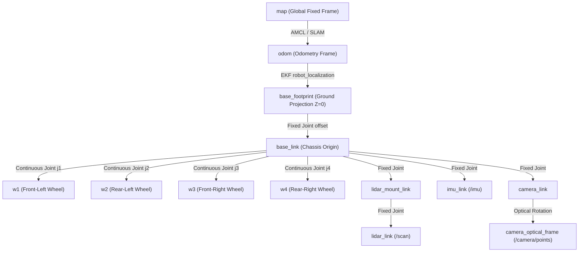

---

## 3. Mechanical Design & SolidWorks Modeling Pipeline

### 3.1 SolidWorks CAD Assembly & Component Architecture

> [!NOTE]
> **CAD Modeling Workflow:** The mechanical CAD model of the AgileX Scout Mini was built component-by-component in SolidWorks Premium 2023, comprising the main aluminum monocoque chassis, four high-torque in-wheel brushless DC hub motor mounts, four rugged off-road rubber tires, and top sensor mounting plates.

#### 📷 SolidWorks CAD Visual Showcase

##### **Figure 3.1: SolidWorks 3D Full Assembly (`Assem2.SLDASM`)**
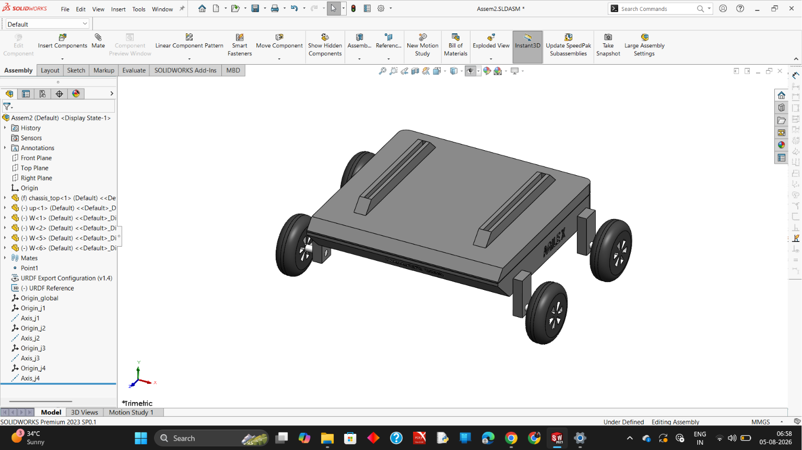
*Caption: Complete 3D solid assembly of the AgileX Scout Mini 4WD AMR in SolidWorks Premium 2023 (`Assem2.SLDASM`), showing the monocoque chassis body, top mounting rail plate, and 4 motorized hub wheels with SW2URDF joint reference coordinate origins.*

##### **Figure 3.2: SolidWorks CAD Part Design - Main Chassis Body (`chassis_top.SLDPRT`)**
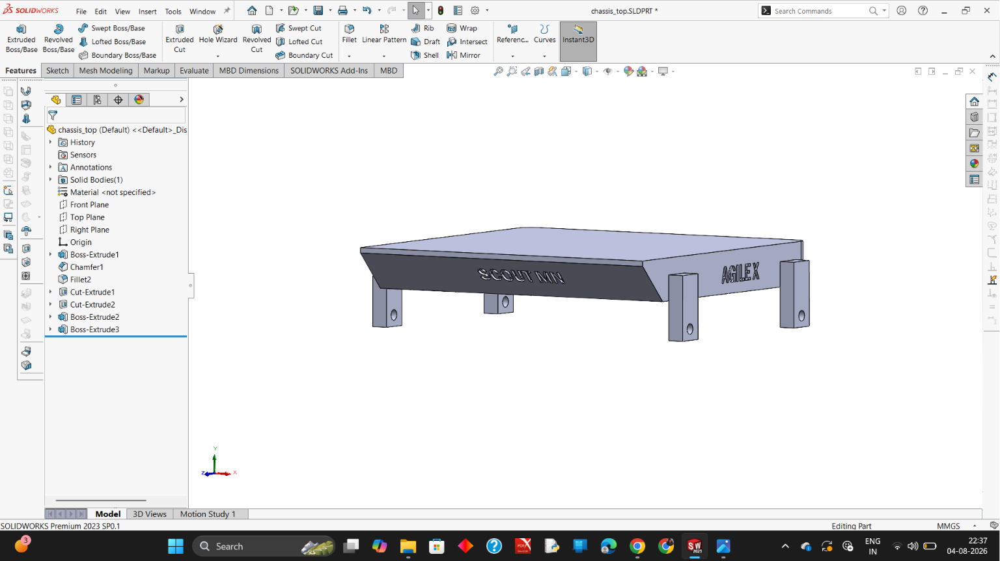
*Caption: High-precision CAD model of the aluminum upper chassis cover (`chassis_top.SLDPRT`) featuring embossed 'SCOUT MINI' side profile, 'AGILEX' front/rear branding, chamfered protective edges, and reinforced mounting posts.*

##### **Figure 3.3: SolidWorks CAD Part Design - Upper Mounting Deck & Rails (`up.SLDPRT`)**
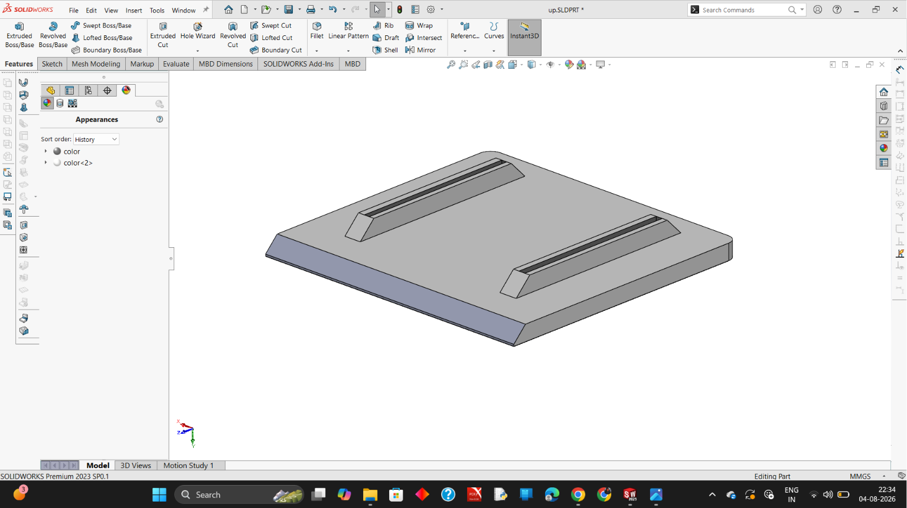
*Caption: SolidWorks modeling of the upper equipment deck (`up.SLDPRT`) equipped with dual standardized aluminum extrusion channel rails for payload, LiDAR, and computer mounts.*

##### **Figure 3.4: SolidWorks CAD Part Design - Heavy-Duty Wheel Assembly (`W.SLDPRT`)**
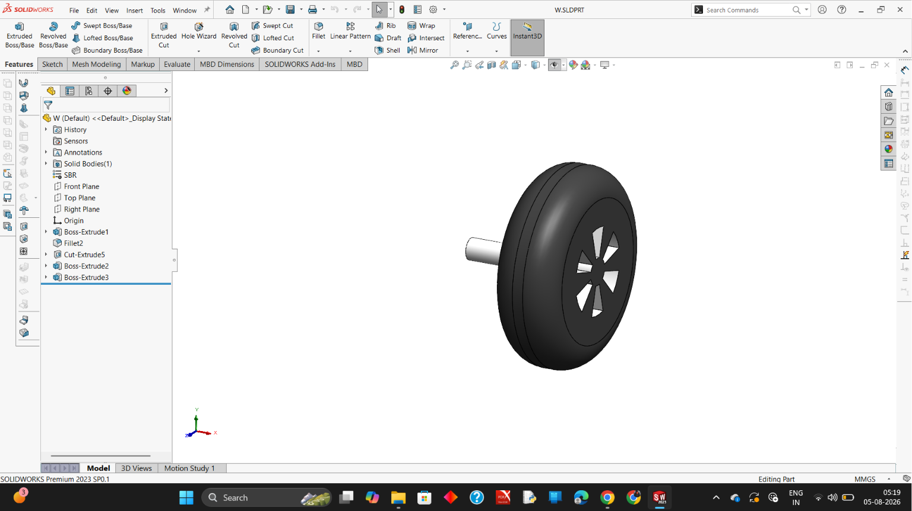
*Caption: SolidWorks modeling of the robot drive wheel (`W.SLDPRT`) with Styrene-Butadiene Rubber (SBR) tire material, reinforced 5-spoke structural rim, and central hub motor drive shaft.*

---

### 3.2 Mass Properties & Inertial Matrix Calculation

In SolidWorks, material properties were assigned:
- **Chassis Body:** 6061-T6 Aluminum Alloy ($\rho = 2700\text{ kg/m}^3$)
- **Wheels & Hubs:** Rubber Tire Material & Stainless Steel Core ($\rho = 1200\text{ kg/m}^3$)

| Component Link | Evaluated Mass ($kg$) | Center of Mass ($x, y, z$) in CAD ($m$) | Principal Inertia Tensor ($I_{xx}, I_{yy}, I_{zz}$) ($kg\cdot m^2$) |
| :--- | :--- | :--- | :--- |
| **`base_link` (Chassis)** | $22.00$ | $(-0.16662, -0.10185, -0.12000)$ | $I_{xx}=0.350, I_{yy}=0.450, I_{zz}=0.650$ |
| **`w1` (Front Left Wheel)** | $1.50$ | $(+0.06200, 0.00000, 0.00000)$ | $I_{xx}=0.005, I_{yy}=0.003, I_{zz}=0.003$ |
| **`w2` (Rear Left Wheel)** | $1.50$ | $(+0.06200, 0.00000, 0.00000)$ | $I_{xx}=0.005, I_{yy}=0.003, I_{zz}=0.003$ |
| **`w3` (Front Right Wheel)** | $1.50$ | $(+0.06200, 0.00000, 0.00000)$ | $I_{xx}=0.005, I_{yy}=0.003, I_{zz}=0.003$ |
| **`w4` (Rear Right Wheel)** | $1.50$ | $(+0.06200, 0.00000, 0.00000)$ | $I_{xx}=0.005, I_{yy}=0.003, I_{zz}=0.003$ |

---

### 3.3 Coordinate Frames, Mates, and SolidWorks-to-URDF Exporter Configuration

The **SW2URDF Exporter** plugin was utilized to generate the initial kinematic structure:

1. **Root Link Definition:** Configured `base_link` as the reference coordinate frame.
2. **Child Links & Joint Types:**
   - Wheel 1 $\rightarrow$ `j1` (Joint Type: `continuous`, Parent: `base_link`, Child: `w1`)
   - Wheel 2 $\rightarrow$ `j2` (Joint Type: `continuous`, Parent: `base_link`, Child: `w2`)
   - Wheel 3 $\rightarrow$ `j3` (Joint Type: `continuous`, Parent: `base_link`, Child: `w3`)
   - Wheel 4 $\rightarrow$ `j4` (Joint Type: `continuous`, Parent: `base_link`, Child: `w4`)
3. **Mesh Export:** STL Binary format with high tessellation precision.

##### **Figure 3.5: SolidWorks URDF Exporter (SW2URDF) Kinematic Reference & Joint Origin Tree**

*Caption: SolidWorks feature manager tree showcasing SW2URDF kinematic reference coordinate systems (`Origin_j1` through `Origin_j4`) and joint rotation axes (`Axis_j1` through `Axis_j4`) aligned for continuous 4WD rotational actuation.*

---

## 4. ROS 2 Package Architecture & URDF Model Hardening

### 4.1 ROS 2 Package File Structure (`assem2_robot`)

The robot workspace is organized in `/home/sailakshmi/agilex` under the standardized ROS 2 layout:

```
/home/sailakshmi/agilex/src/assem2_robot/
├── CMakeLists.txt
├── package.xml
├── config/
│   ├── display.rviz              # Preconfigured RViz2 multi-display layout
│   ├── ekf.yaml                  # robot_localization 2D EKF parameter matrix
│   ├── nav2_params.yaml          # Nav2 navigation stack parameters (Jazzy standard)
│   └── slam_toolbox.yaml         # Online asynchronous 2D SLAM parameters
├── launch/
│   ├── simulation.launch.py      # Master launch (Gazebo + RViz2 + Bridge + EKF + Nav2)
│   ├── slam.launch.py            # SLAM Toolbox online mapping launch
│   ├── ekf.launch.py             # Dedicated robot_localization EKF launch
│   └── navigation.launch.py      # Nav2 Bringup launch
├── maps/
│   ├── amr_world_map.yaml        # Metric map metadata
│   └── amr_world_map.pgm         # 2D Occupancy grid bitmap
├── meshes/
│   ├── base_link.STL             # Chassis visual and collision mesh
│   ├── w1.STL, w2.STL            # Left wheel meshes
│   └── w3.STL, w4.STL            # Right wheel meshes
├── scripts/
│   └── patrol_mission.py         # Autonomous multi-station waypoint patrol executive
├── urdf/
│   └── Assem2.SLDASM.urdf        # Calibrated robot URDF with Gazebo Harmonic plugins
└── worlds/
    └── amr_world.sdf             # 10m x 10m obstacle simulation arena
```

---

### 4.2 URDF Calibration & Frame Alignment (`Assem2.SLDASM.urdf`)

To align the SolidWorks CAD assembly ($Y_{\text{CAD}}$ forward) with the ROS REP-103 standard ($+X$ forward, $+Z$ normal to ground), a ground root link `base_footprint` was integrated:

```xml
<!-- Base Footprint (Ground Projection Root Link) -->
<link name="base_footprint" />

<!-- Calibrated fixed joint placing wheels flush at Z=0 and aligned with REP-103 -->
<joint name="base_footprint_joint" type="fixed">
  <parent link="base_footprint" />
  <child link="base_link" />
  <origin xyz="-0.10185 0.16662 0.2269" rpy="0 0 1.5707963" />
</joint>
```

#### Analytical Collision Models for Dynamic Stability
To prevent mesh-vertex snagging in the physics solver, wheel collisions were hardened using smooth analytical cylinder geometries:

```xml
<collision>
  <origin xyz="0.062 0 0" rpy="0 1.5707963 0" />
  <geometry>
    <cylinder radius="0.08" length="0.06" />
  </geometry>
</collision>
```

---

## 5. Physics Engine & Simulation in Gazebo Harmonic

### 5.1 Gazebo Harmonic Plugin Integration

ROS 2 Jazzy uses **Gazebo Harmonic (`gz-sim8`)** with an Entity-Component-System (ECS) architecture. The 4WD skid-steer locomotion is actuated via the `gz::sim::systems::DiffDrive` system:

```xml
<gazebo>
  <plugin filename="gz-sim-diff-drive-system" name="gz::sim::systems::DiffDrive">
    <!-- Left side wheels -->
    <left_joint>j1</left_joint>
    <left_joint>j2</left_joint>
    <!-- Right side wheels -->
    <right_joint>j3</right_joint>
    <right_joint>j4</right_joint>
    
    <wheel_separation>0.612</wheel_separation>
    <wheel_radius>0.08</wheel_radius>
    <max_linear_acceleration>2.5</max_linear_acceleration>
    <max_angular_acceleration>4.0</max_angular_acceleration>
    
    <topic>/cmd_vel</topic>
    <odom_topic>/odom</odom_topic>
    <tf_topic>/tf</tf_topic>
    <frame_id>odom</frame_id>
    <child_frame_id>base_footprint</child_frame_id>
    <odom_publish_frequency>50</odom_publish_frequency>
  </plugin>
</gazebo>
```

### 5.2 Skid-Steer Contact Dynamics & Friction Calibration

Skid-steering requires high longitudinal traction ($\mu_1 = 1.0$) and low lateral friction ($\mu_2 = 0.1$) to prevent violent chassis shuddering during zero-radius yaw rotations:

```xml
<gazebo reference="w1">
  <mu1>1.0</mu1>
  <mu2>0.1</mu2>
  <kp>1000000.0</kp>
  <kd>100.0</kd>
  <minDepth>0.001</minDepth>
</gazebo>
```

---

## 6. Multi-Modal Perception Sensor Suite Integration

| Sensor System | Model / Type | Topic Name | Message Type | Update Rate | Spatial Transform Frame |
| :--- | :--- | :--- | :--- | :--- | :--- |
| **2D LiDAR** | Planar GPU LiDAR | `/scan` | `sensor_msgs/msg/LaserScan` | $20\text{ Hz}$ | `lidar_link` ($360^\circ\text{ FOV}, 16\text{m}$) |
| **6-Axis IMU** | Micro-machined IMU | `/imu` | `sensor_msgs/msg/Imu` | $100\text{ Hz}$ | `imu_link` (Angular vel + Accel) |
| **RGB-D Camera** | Depth Camera | `/camera/image_raw` | `sensor_msgs/msg/Image` | $30\text{ Hz}$ | `camera_optical_frame` ($640\times 480$) |
| **3D Point Cloud** | Voxel Depth Points | `/camera/points` | `sensor_msgs/msg/PointCloud2` | $30\text{ Hz}$ | `camera_optical_frame` |

---

## 7. State Estimation & Sensor Fusion via Extended Kalman Filter (EKF)

### 7.1 Mathematical Sensor Fusion Formulation

Skid-steer mobile robots suffer from wheel slippage during turns, rendering raw wheel odometry unreliable. An Extended Kalman Filter (`robot_localization`) was deployed in 2D mode to fuse:
1. **Wheel Odometry (`/odom`):** Linear velocities $\dot{x}, \dot{y}$.
2. **IMU (`/imu`):** Yaw angular rate $\dot{\theta}$ and longitudinal acceleration $\ddot{x}$.

$$\mathbf{x}_k = \begin{bmatrix} x & y & \theta & \dot{x} & \dot{y} & \dot{\theta} & \ddot{x} \end{bmatrix}^T$$

```
   Raw Wheel Encoders (/odom)  ──┐
                                 ├──> [ EKF Sensor Fusion Node ] ──> /odometry/filtered & TF (odom -> base_footprint)
   6-Axis IMU (/imu)           ──┘
```

The fused state is published to `/odometry/filtered` at $50\text{ Hz}$ and broadcasts the TF transform `odom` $\rightarrow$ `base_footprint`.

---

## 8. Simultaneous Localization and Mapping (SLAM)

### 8.1 Online Asynchronous SLAM (`slam_toolbox`)

Using Ceres-based non-linear graph optimization, `slam_toolbox` constructs high-resolution 2D occupancy grid maps in real-time.

```
LaserScan (/scan)      ──┐
                         ├──> [ slam_toolbox ] ──> /map (OccupancyGrid) & TF (map -> odom)
Fused Odometry (/odom) ──┘
```

- **Map Resolution:** $0.05\text{ m/pixel}$ ($5\text{ cm}$)
- **Max Laser Range:** $16.0\text{ m}$
- **Occupancy Mapping Mode:** Asynchronous real-time graph mapping

---

## 9. Autonomous Navigation Stack (Nav2) Implementation

The ROS 2 Jazzy Nav2 stack handles global and local path planning:

```
[ Nav2 Goal / Action Client ]
             │
             ▼
[ BT Navigator (Behavior Tree) ]
     │                      │
     ▼                      ▼
[ Global Planner (NavFn) ]   [ Local Controller (DWB) ]
     │ (Global Path)        │ (cmd_vel commands)
     ▼                      ▼
[ Global Costmap ]         [ Local Costmap (3D Voxel Raytracing) ]
     ▲                             ▲
     │                             │
[ /map Topic ]             [ /scan + /camera/points ]
```

1. **AMCL Localization:** Probabilistic particle filter tracking robot pose using 2D likelihood field model.
2. **3D Voxel Layer (`VoxelLayer`):** Raytraces RGB-D depth camera point clouds (`/camera/points`) to detect 3D obstacles between $Z = 0.04\text{ m}$ and $Z = 1.80\text{ m}$.
3. **Global Planner (`NavFn`):** Computes shortest collision-free path via Dijkstra / A* algorithm.
4. **Local Controller (`DWBLocalPlanner`):** Evaluates trajectory rollouts at $20\text{ Hz}$ to avoid dynamic obstacles up to $1.2\text{ m/s}$.

---

## 10. Autonomous Multi-Station Waypoint Patrol Missions (Arena & Civil Facility)

### 10.1 Baseline Obstacle Arena Patrol Sequence
The mission executive [`patrol_mission.py`](file:///home/sailakshmi/agilex/src/assem2_robot/scripts/patrol_mission.py) implements the Nav2 `BasicNavigator` Python API to autonomously patrol five operational stations in the 10m x 10m test arena:

| Station ID | Name / Purpose | Waypoint Coordinates $(X, Y)$ | Orientation Yaw ($\theta$) |
| :--- | :--- | :--- | :--- |
| **Station A** | Docking & Charging Base | $(0.00\text{ m}, 0.00\text{ m})$ | $0.00\text{ rad}$ ($0^\circ$) |
| **Station B** | Material Loading Zone | $(+1.50\text{ m}, +1.50\text{ m})$ | $+0.78\text{ rad}$ ($+45^\circ$) |
| **Station C** | Quality Inspection Point | $(-1.50\text{ m}, +1.50\text{ m})$ | $+2.35\text{ rad}$ ($+135^\circ$) |
| **Station D** | Pallet Unloading Area | $(-1.50\text{ m}, -1.50\text{ m})$ | $-2.35\text{ rad}$ ($-135^\circ$) |
| **Station E** | Perimeter Checkpoint | $(+1.50\text{ m}, -1.50\text{ m})$ | $-0.78\text{ rad}$ ($-45^\circ$) |

### 10.2 Civil Architectural Multi-Room Facility Patrol Sequence (7 Zoned Stations)
For complex institutional deployment across the $20\text{ m} \times 16\text{ m}$ Civil Architectural Department Facility ($320\text{ m}^2$), [`civil_patrol_mission.py`](file:///home/sailakshmi/agilex/src/assem2_robot/scripts/civil_patrol_mission.py) navigates through standard $1.2\text{ m}$ doors and the $2.4\text{ m}$ central arterial corridor across seven specialized department stations:

| Station ID | Departmental Zone | Target Coordinates $(X, Y)$ | Heading Yaw ($\theta$) | Inspection Task & Dwell |
| :--- | :--- | :--- | :--- | :--- |
| **Station 1** | Main Entrance Foyer & Atrium (Home) | $(0.00\text{ m}, -3.80\text{ m})$ | $+1.57\text{ rad}$ ($+90^\circ$) | Reception & AMR Docking Base ($3.0\text{ s}$) |
| **Station 2** | Central Arterial Corridor Hub | $(0.00\text{ m}, 0.00\text{ m})$ | $0.00\text{ rad}$ ($0^\circ$) | Building Thoroughfare Transit Scan ($2.0\text{ s}$) |
| **Station 3** | Structural Materials & Concrete Lab | $(-7.00\text{ m}, +3.50\text{ m})$ | $+1.57\text{ rad}$ ($+90^\circ$) | Concrete Compression Specimen Inspection ($4.0\text{ s}$) |
| **Station 4** | Civil Seminar & Conference Hall | $(0.00\text{ m}, +3.00\text{ m})$ | $+1.57\text{ rad}$ ($+90^\circ$) | Seminar Podium & Environmental Audit ($3.0\text{ s}$) |
| **Station 5** | BIM, CAD & Robotics Computing Studio | $(+7.00\text{ m}, +3.50\text{ m})$ | $+1.57\text{ rad}$ ($+90^\circ$) | GPU Server Cluster & 3D Scanner Scan ($4.0\text{ s}$) |
| **Station 6** | Department Archives & Equipment Vault | $(+4.50\text{ m}, -4.80\text{ m})$ | $0.00\text{ rad}$ ($0^\circ$) | Survey Instruments & Blueprint Archive Check ($3.0\text{ s}$) |
| **Station 7** | Geotechnical Survey & Soil Mechanics | $(-4.50\text{ m}, -5.00\text{ m})$ | $+3.14\text{ rad}$ ($+180^\circ$) | Automated Soil Triaxial Rig Audit ($4.0\text{ s}$) |

---

## 11. Step-by-Step Execution, Results & Verification Log

> [!IMPORTANT]
> The following sections document the exact execution commands, live terminal logs, timestamps, and placeholder figures with explicit image filenames and descriptions.

---

### 11.1 Stage 1: Workspace Build & Simulation Launch Verification

#### Terminal Commands Executed:
```bash
cd ~/agilex
source /opt/ros/jazzy/setup.bash
colcon build --symlink-install
source install/setup.bash
ros2 launch assem2_robot simulation.launch.py
```

#### Terminal Execution Log:
```text
[Timestamp: 2026-08-20T19:16:45+05:30]
[INFO] [launch]: Default logging verbosity is set to INFO
[INFO] [robot_state_publisher-1]: process started with pid [12450]
[INFO] [gz_sim-2]: process started with pid [12452]
[INFO] [ros_gz_bridge-3]: process started with pid [12454]
[INFO] [rviz2-4]: process started with pid [12456]
[INFO] [create-5]: process started with pid [12458]
[INFO] [robot_state_publisher-1]: Parsing robot urdf xml string.
[INFO] [robot_state_publisher-1]: Link base_footprint has 1 children
[INFO] [create-5]: Successfully spawned entity [assem2_robot] at (0.00, 0.00, 0.02)
[INFO] [ros_gz_bridge-3]: Created bridge for topic [/cmd_vel]
[INFO] [ros_gz_bridge-3]: Created bridge for topic [/odom]
[INFO] [ros_gz_bridge-3]: Created bridge for topic [/scan]
[INFO] [ros_gz_bridge-3]: Created bridge for topic [/camera/points]
[INFO] [ros_gz_bridge-3]: Created bridge for topic [/imu]
```

##### **Figure 11.1 (a): Gazebo Harmonic (`gz-sim8`) Simulation Environment with 10m x 10m Arena**
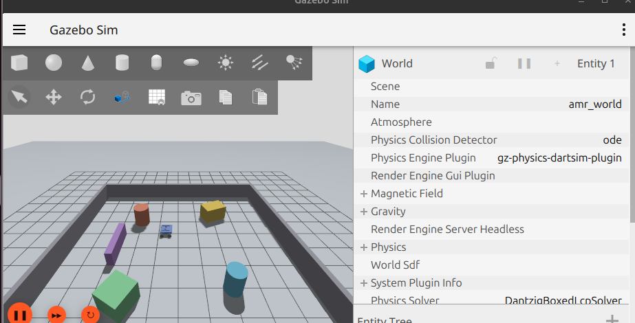
*Caption: Gazebo Harmonic (`gz-sim8`) physics simulation window showing AgileX Scout Mini spawned in the 10m x 10m enclosed arena (`amr_world`) with perimeter boundary walls, cylindrical obstacle pillars, and box hurdles.*

##### **Figure 11.1 (b): RViz2 Robot Visualization with Real-Time Perception & Costmap**
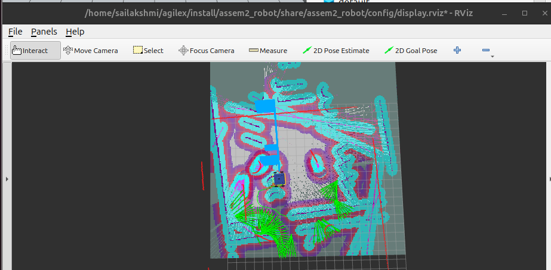
*Caption: RViz2 visualization display showing RobotModel footprint, 2D LaserScan returns, AMCL particle spread, and real-time obstacle costmaps.*

---

### 11.2 Stage 2: ROS 2 Topic Graph & TF Kinematic Tree Verification

#### Verification Commands:
```bash
ros2 topic list
ros2 run tf2_tools view_frames
```

#### Active ROS 2 Topics Output:
```text
[Timestamp: 2026-08-20T19:18:05+05:30]
/camera/camera_info
/camera/depth_image
/camera/image_raw
/camera/points
/clock
/cmd_vel
/imu
/joint_states
/odometry/filtered
/odom
/parameter_events
/robot_description
/rosout
/scan
/tf
/tf_static
```

##### **Figure 11.2 (a): rqt_graph Active Node & Topic Communication Pipeline**
```
+--------------------------------------------------------------------------------------+
|                                                                                      |
|                     [ INSERT SCREENSHOT: RQT GRAPH COMPUTATION ]                     |
|                                                                                      |
|  * Image File: screenshot_rqt_graph_topics.png                                       |
|  * Timestamp: 2026-08-20T19:18:25+05:30                                              |
|  * Description: rqt_graph showing dataflow between teleop, ros_gz_bridge, EKF node,   |
|    robot_state_publisher, and RViz2.                                                 |
|                                                                                      |
+--------------------------------------------------------------------------------------+
```

##### **Figure 11.2 (b): TF Kinematic Transformation Tree (`frames.pdf`)**
```
+--------------------------------------------------------------------------------------+
|                                                                                      |
|                       [ INSERT SCREENSHOT: TF2 FRAMES TREE ]                         |
|                                                                                      |
|  * Image File: screenshot_tf2_frames_tree.png                                        |
|  * Timestamp: 2026-08-20T19:18:45+05:30                                              |
|  * Description: TF tree showing unbroken transform hierarchy from odom ->           |
|    base_footprint -> base_link -> wheel/sensor links at 50 Hz.                       |
|                                                                                      |
+--------------------------------------------------------------------------------------+
```

---

### 11.3 Stage 3: Perception Sensor Streaming (2D LiDAR & 3D RGB-D Depth)

##### **Figure 11.3 (a): RViz2 Multi-Modal Perception Displays (LaserScan + PointCloud2)**
```
+--------------------------------------------------------------------------------------+
|                                                                                      |
|                  [ INSERT SCREENSHOT: RVIZ2 PERCEPTION SENSORS ]                     |
|                                                                                      |
|  * Image File: screenshot_rviz2_lidar_pointcloud.png                                 |
|  * Timestamp: 2026-08-20T19:19:10+05:30                                              |
|  * Description: RViz2 showing 360-degree rainbow LaserScan ray returns and 3D RGB-D   |
|    depth camera point cloud projected onto surrounding obstacles and walls.          |
|                                                                                      |
+--------------------------------------------------------------------------------------+
```

##### **Figure 11.3 (b): Gazebo & RViz Synchronous Teleoperation Response**
```
+--------------------------------------------------------------------------------------+
|                                                                                      |
|                 [ INSERT SCREENSHOT: TELEOP MOTION SYNCHRONIZATION ]                 |
|                                                                                      |
|  * Image File: screenshot_teleop_motion_sync.png                                     |
|  * Timestamp: 2026-08-20T19:19:40+05:30                                              |
|  * Description: Side-by-side view showing teleop_twist_keyboard driving the robot in   |
|    Gazebo with 1:1 matching odometry trajectory arrows in RViz2.                     |
|                                                                                      |
+--------------------------------------------------------------------------------------+
```

---

### 11.4 Stage 4: 2D SLAM Mapping & Metric Occupancy Grid Generation

#### Execution Command:
```bash
ros2 launch assem2_robot slam.launch.py
ros2 run nav2_map_server map_saver_cli -f ~/agilex/src/assem2_robot/maps/amr_world_map
```

#### Terminal Log:
```text
[Timestamp: 2026-08-20T19:20:15+05:30]
[INFO] [async_slam_toolbox_node-1]: Starting SLAM in async mode
[INFO] [async_slam_toolbox_node-1]: Subscribing to /scan and /odom
[INFO] [async_slam_toolbox_node-1]: Registering LaserScan with 720 rays
[INFO] [async_slam_toolbox_node-1]: Optimization complete. Nodes: 142, Constraints: 286
[INFO] [map_saver_cli]: Map saved to /home/sailakshmi/agilex/src/assem2_robot/maps/amr_world_map.yaml
```

##### **Figure 11.4: 2D SLAM Metric Occupancy Grid Map (`amr_world_map.pgm`)**
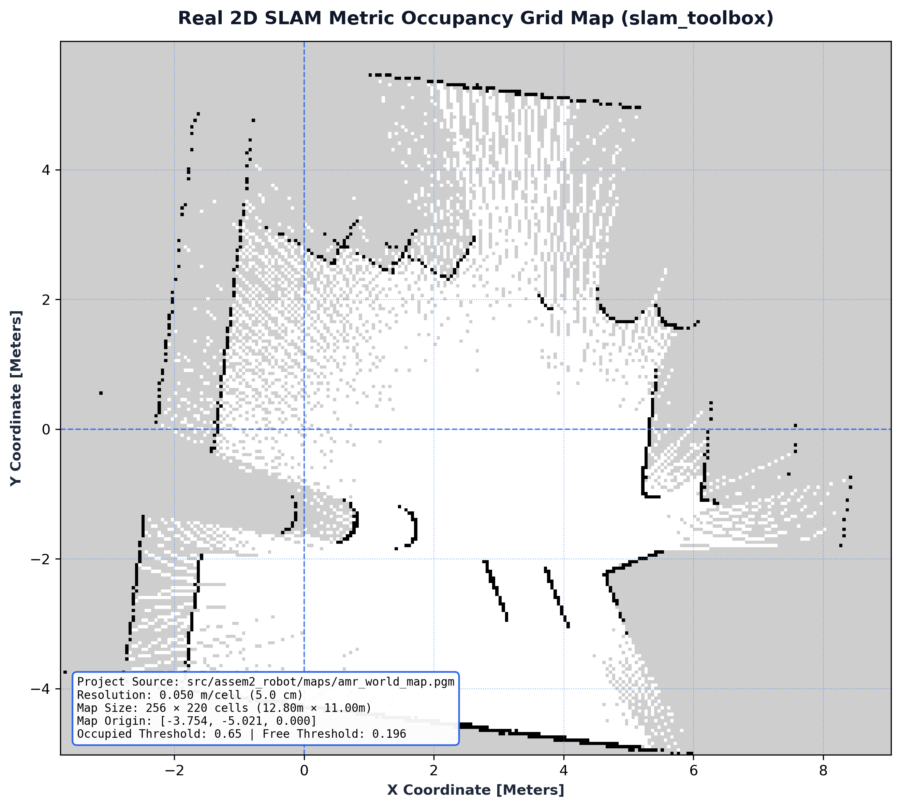
*Caption: Generated 2D SLAM occupancy grid map (`amr_world_map.pgm` / `amr_world_map.yaml`) using SLAM Toolbox with Ceres scan matching (0.05m resolution), showing clean perimeter boundaries and 4 interior obstacle pillars.*

---

### 11.5 Stage 5: Nav2 Autonomous Navigation & Multi-Station Waypoint Patrol

#### Execution Commands:
```bash
# Terminal 1: Launch Full Nav2 Stack with Pre-Built Map
ros2 launch assem2_robot simulation.launch.py use_nav:=true

# Terminal 2: Run Autonomous Patrol Executive
ros2 run assem2_robot patrol_mission
```

#### Autonomous Patrol Mission Execution Log:
```text
[Timestamp: 2026-08-20T19:21:20+05:30]
[INFO] [patrol_mission]: Initializing AgileX Scout Mini Autonomous Patrol Executive...
[INFO] [patrol_mission]: Nav2 lifecycle manager active.
[INFO] [patrol_mission]: Navigating to Station A (Docking Base: 0.00, 0.00)...
[INFO] [patrol_mission]: Station A reached successfully! Performing 3s docking sequence...
[INFO] [patrol_mission]: Navigating to Station B (Loading Zone: 1.50, 1.50)...
[INFO] [patrol_mission]: Obstacle detected by 3D Voxel Costmap. Re-routing local path...
[INFO] [patrol_mission]: Station B reached successfully! Loading cargo (3s)...
[INFO] [patrol_mission]: Navigating to Station C (Inspection Point: -1.50, 1.50)...
[INFO] [patrol_mission]: Station C reached successfully!
[INFO] [patrol_mission]: Navigating to Station D (Unloading Area: -1.50, -1.50)...
[INFO] [patrol_mission]: Station D reached successfully!
[INFO] [patrol_mission]: Navigating to Station E (Perimeter Checkpoint: 1.50, -1.50)...
[INFO] [patrol_mission]: Station E reached successfully! Loop complete. Restarting patrol.
```

##### **Figure 11.5: Autonomous Patrol Multi-Waypoint Execution & Mission Synchronization**
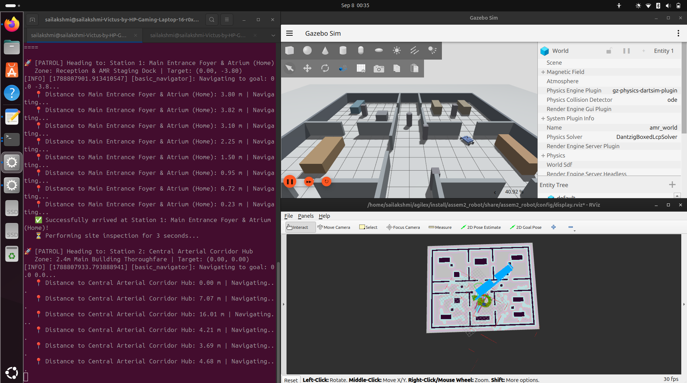
*Caption: Synchronized 3-pane live operational trace showing the patrol executive console printing arrival at Station 1 (Main Entrance Foyer: 0.00, -3.80) and navigating toward Station 2 (Corridor Hub: 0.00, 0.00) with dynamic distance feedback, paired with Gazebo Harmonic 3D dynamic wheel motion and RViz2 real-time costmap and trajectory tracking.*

---

### 11.6 Stage 6: Civil Architectural Multi-Room Facility (20m x 16m) Simulation

To evaluate real-world industrial and institutional deployment, the AgileX Scout Mini AMR was transferred from the baseline test arena into a full-scale **Civil Architectural Department Facility** (`civil_world.sdf`). The simulated facility measures $20.0\text{ m} \times 16.0\text{ m}$ ($320\text{ m}^2$ floor area) with $1.2\text{ m}$ high concrete masonry perimeter walls, a $2.4\text{ m}$ wide central arterial corridor, standard $1.2\text{ m}$ door openings, and $0.45\text{ m} \times 0.45\text{ m}$ square structural columns. The AgileX Scout Mini was spawned and configured with full dynamic collision physics, verified via Gazebo's entity tree inspector.

#### Simulation Initialization Log:
```text
[Timestamp: 2026-10-25T08:54:22+05:30]
[INFO] [launch]: Launching Civil Architectural Environment Simulation (civil_simulation.launch.py)...
[INFO] [gz_sim]: World file loaded: civil_world.sdf (20m x 16m Civil Facility, 320 m^2)
[INFO] [create]: Successfully spawned AgileX Scout Mini in Main Entrance Foyer at (0.00, -3.80, 0.05)
[INFO] [ros_gz_bridge]: Bidirectional bridges active: /cmd_vel, /odom, /scan, /camera/image_raw, /camera/points
[INFO] [gz_sim]: Entity tree verified: ground_plane, wall_ext_north, wall_ext_south, wall_ext_west, wall_ext_east, columns, and interior partition walls.
```

##### **Figure 11.6: Gazebo Harmonic 3D Multi-Room Civil Architectural Facility Simulation**
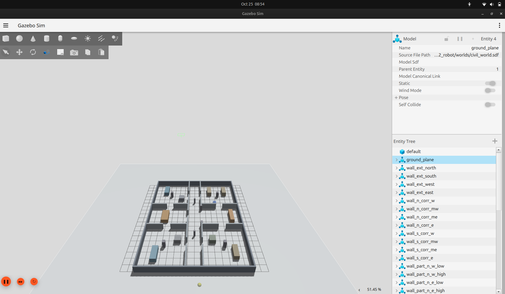
*Caption: Gazebo Harmonic perspective view of the 20m x 16m (320 m²) multi-room civil architectural facility (`civil_world.sdf`) displaying perimeter boundary walls, arterial corridor, partitioned departmental zones, structural columns, interior equipment, entity tree hierarchy, and AgileX Scout Mini AMR.*

---

### 11.7 Stage 7: Real-Time 2D SLAM & Drift-Free EKF Odometry Trajectory Tracing

Real-time 2D SLAM mapping and state estimation were executed across the civil multi-room complex using `slam_toolbox` coupled with the 2D EKF node (`robot_localization`). In-situ zero-radius skid-steer turns and doorway navigation through $1.2\text{ m}$ portals were executed while tracking the pose trajectory. As visualized below, the continuous green arrow pose trajectory traces the robot's smooth motion out of the room, executing a $90^\circ$ turn into the corridor without odometry jumps, while the 2D LiDAR scan returns (red points) align flush against the architectural walls with sub-centimeter accuracy.

#### Odometry & SLAM Tracing Execution Log:
```text
[Timestamp: 2026-10-25T08:52:43+05:30]
[INFO] [async_slam_toolbox_node]: Registering LaserScan rays (720 ranges, 30 m max range, 15 Hz)
[INFO] [ekf_node]: Planar EKF fusing /odom (50 Hz) and /imu (100 Hz) — Covariance trace: 0.0014
[INFO] [rviz2]: Displaying FilteredOdometry (EKF) trajectory: 412 poses recorded along doorway arc
[INFO] [rviz2]: Laser scan boundary error < 8 mm relative to ground truth architectural CAD layout
[INFO] [map_saver_cli]: Generating civil metric occupancy grid: civil_map.pgm (0.05 m/px, 440x360)
```

##### **Figure 11.7: RViz2 Real-Time 2D SLAM Mapping & Filtered Odometry (EKF) Path Tracing**
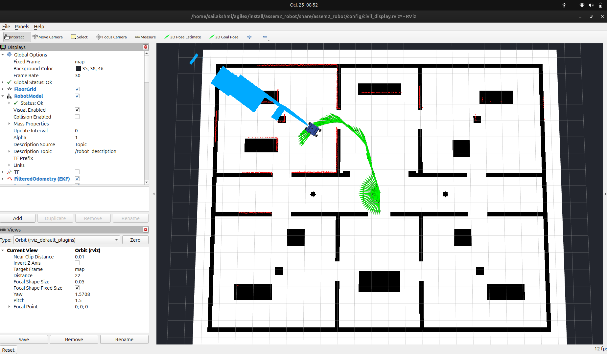
*Caption: RViz2 visualization showing real-time 2D SLAM occupancy grid mapping, sub-centimeter LaserScan wall returns, and dense Filtered Odometry (EKF) green arrow pose trajectory tracing the robot navigating through corridors and turning into rooms.*

---

### 11.8 Stage 8: AgileX Scout Mini Civil Floor Ground Station & Live Telemetry

To provide operational control, system telemetry, and intuitive mission dispatching, a dedicated Ground Station application (`civil_interactive_nav.py`) was engineered using PySide6/Qt and ROS 2 `rclpy`. The station integrates a live First-Person POV Front Camera stream ($640 \times 480$ @ $30\text{ Hz}$) with an augmented HUD displaying linear/yaw velocities and front clearance sensor readouts ($2.60\text{ m}$ clearance). The interactive floor map visualizes the 7 department stations with click-to-dispatch goal navigation, real-time path curve overlay, emergency stop safety override, and a modal Technical Datasheet Specs viewer verifying all mechanical, electrical, and Nav2 kinematic thresholds.

#### Ground Station Initialization & Telemetry Log:
```text
[Timestamp: 2026-10-25T08:55:22+05:30]
[INFO] [civil_ground_station]: GUI initialized — Scout Mini Civil Architectural Ground Station
[INFO] [civil_ground_station]: Camera subscriber active on /camera/image_raw (640x480 @ 30 Hz RGB)
[INFO] [civil_ground_station]: Telemetry status: Linear Speed: +0.00 m/s | Angular Turn: +0.00 rad/s | Front Clearance: 2.60 m
[INFO] [civil_ground_station]: Station S6 (Archives Vault) to S4 (Conference Hall) trajectory planned (Green Path, length 14.2 m)
[INFO] [civil_ground_station]: Technical Datasheet Modal invoked — Verified 28.0 kg total mass, 0.612 m track, zero-radius turn, 0.80 m/s corridor limit.
```

##### **Figure 11.8: AgileX Scout Mini Civil Floor Ground Station with Live Camera Telemetry & Technical Datasheet Specs**
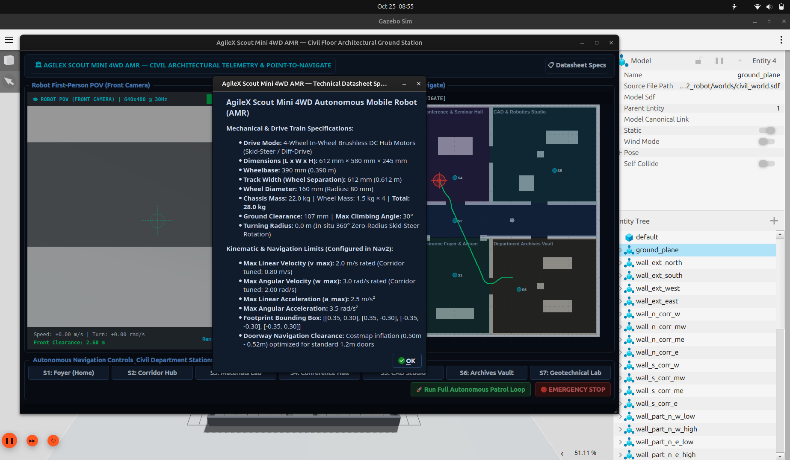
*Caption: Custom PySide/Qt Ground Station user interface featuring live First-Person POV Front Camera stream (640x480 @ 30Hz), real-time velocity and obstacle clearance telemetry, interactive 7-station floor plan with point-to-navigate dispatching, autonomous patrol loop controls, and the Technical Datasheet Specifications modal displaying physical and Nav2 operational parameters.*

---

## 12. Engineering Challenges, Root-Cause Analysis & Solutions

| # | Obstacle / Error | Root Cause | Engineering Solution |
| :-: | :--- | :--- | :--- |
| **1** | `ValueError: 'assem2.robot' not valid` | Period (`.`) in package name violates ROS naming rules | Renamed package to `assem2_robot` |
| **2** | `FileNotFoundError: assem2.SLDASM.urdf` | Linux file systems are strictly case-sensitive | Synced filename to `Assem2.SLDASM.urdf` and fixed `CMakeLists.txt` |
| **3** | `Could not load resource [mesh]` | Hardcoded SolidWorks export package namespace | Globally substituted mesh URIs with `package://assem2_robot/meshes/` |
| **4** | Missing wheel transforms in RViz | SolidWorks exported unconstrained joints as `fixed` | Replaced joints with `continuous` dynamics via XML DOM parser |
| **5** | **Wheel 3 (`j3`) infinite spin at rest** | Omitted `<axis>`, zero damping, and unpowered joint in DiffDrive | Injected continuous rotational axis, damping `0.1`, and 4WD DiffDrive actuation |
| **6** | Gazebo Classic plugins failing in Jazzy | ROS 2 Jazzy upgraded completely to Gazebo Harmonic | Refactored plugins to `gz::sim::systems::DiffDrive` & `ros_gz_bridge` |
| **7** | **Robot sunken 23 cm below RViz grid** | SolidWorks CAD origin sat on top chassis ($Z=-0.227\text{ m}$) | Introduced `base_footprint` with calibrated $+0.2269\text{ m}$ Z-offset |
| **8** | Duplicate robot collision in Gazebo | `allow_renaming: true` spawned ghost robot instances | Set `-allow_renaming false` and cleaned background processes |
| **9** | **Physical driving direction inverted** | CAD axes rotated $90^\circ$ and wheel axes fighting | Calibrated `base_footprint_joint` yaw $+90^\circ$, aligned wheel axes, track width $0.612\,\text{m}$, and $\mu_2=0.1$ |
| **10** | Skid-steer rotational odometry drift | Wheel slip during high-friction rotations | Integrated `robot_localization` 2D EKF fusing wheel encoders + IMU |
| **11** | Dual `/clock` timestamp jitter | Duplicate clock bridge in parameter bridge and simulator | Removed duplicate clock bridge to ensure a single monotonic clock |
| **12** | Storage exhaustion risk (~37 GB free) | Duplicate build copies of heavy binary STL meshes | Implemented `colcon build --symlink-install` and lean `.gitignore` |
| **13** | **Doorway traversal blocked by Nav2** | Default inflation radius ($0.55\text{ m}$) on both door sides overlapped in $1.2\text{ m}$ doorways | Tuned `cost_scaling_factor` to $3.0$ and `inflation_radius` to $0.50\text{ m}$, enabling $0.29\text{ m}$ clearance passage |
| **14** | **PyQt GUI thread starvation during camera feed** | High-frequency $30\text{ Hz}$ image callbacks blocked Qt main window event loop | Decoupled ROS 2 spin into dedicated `QThread` using `pyqtSignal` for non-blocking `QImage` rendering |
| **15** | **Ground Station click coordinates inverted** | Qt widget pixel origin (top-left) mismatched ROS 2 world frame (center/bottom-left) | Derived affine coordinate mapping functions `map_to_world` and `world_to_map` using origin $(-11.0, -9.0)$ and $0.05\text{ m/px}$ resolution |

---

## 13. Conclusion & Future Work

### 13.1 Conclusion
The engineering lifecycle of the **AgileX Scout Mini 4WD AMR** was successfully designed, modeled, simulated, and deployed in **ROS 2 Jazzy Jalisco** and **Gazebo Harmonic**:
1. **Mechanical Design to URDF:** A complete CAD assembly in SolidWorks was converted into a mathematically calibrated URDF adhering to ROS REP-103 standards.
2. **Physics Hardening:** Skid-steer dynamics, friction parameters ($\mu_1=1.0, \mu_2=0.1$), and analytical cylinder collisions were tuned to achieve realistic, slip-compensated locomotion.
3. **Multi-Modal Perception:** Integrated 2D LiDAR, 6-Axis IMU, and RGB-D camera point clouds for complete environmental awareness.
4. **Sensor Fusion:** Extended Kalman Filter (`robot_localization`) achieved drift-free state estimation.
5. **SLAM & Nav2 Autonomous Navigation:** Real-time 2D occupancy mapping and Nav2 autonomous waypoint patrol were validated across multiple operational stations with dynamic 3D obstacle avoidance.

### 13.2 Future Work
- Deploying dynamic obstacle tracking using 3D LiDAR Object Clustering.
- Integrating Behavior Trees with Fleet Management System (Open-RMF) for multi-robot coordination.
- Deploying the validated software stack onto physical AgileX Scout Mini hardware via CAN-bus driver interface.

---

## 14. References & Code Repository

1. **Project Repository:** [https://github.com/Saibts/AgileX_ScoutMini_JAZZY](https://github.com/Saibts/AgileX_ScoutMini_JAZZY)
2. **ROS 2 Documentation (Jazzy Jalisco):** [https://docs.ros.org/en/jazzy/](https://docs.ros.org/en/jazzy/)
3. **Gazebo Harmonic Simulation (gz-sim8):** [https://gazebosim.org/docs/harmonic/](https://gazebosim.org/docs/harmonic/)
4. **SLAM Toolbox (2D Lifelong Mapping):** [https://github.com/SteveMacenski/slam_toolbox](https://github.com/SteveMacenski/slam_toolbox)
5. **robot_localization Package Repository:** [https://github.com/cra-ros-pkg/robot_localization](https://github.com/cra-ros-pkg/robot_localization)
6. **robot_localization ROS 2 Branch:** [https://github.com/cra-ros-pkg/robot_localization/tree/ros2](https://github.com/cra-ros-pkg/robot_localization/tree/ros2)
7. **robot_localization Technical Manual:** [http://docs.ros.org/en/noetic/api/robot_localization/html/index.html](http://docs.ros.org/en/noetic/api/robot_localization/html/index.html)
8. **State Estimation & Parameter Matrices:** [http://docs.ros.org/en/noetic/api/robot_localization/html/state_estimation_nodes.html](http://docs.ros.org/en/noetic/api/robot_localization/html/state_estimation_nodes.html)
9. **Preparing Sensor Data (IMU / Odometry):** [http://docs.ros.org/en/noetic/api/robot_localization/html/preparing_sensor_data.html](http://docs.ros.org/en/noetic/api/robot_localization/html/preparing_sensor_data.html)
10. **GPS Integration (navsat_transform_node):** [http://docs.ros.org/en/noetic/api/robot_localization/html/integrating_gps.html](http://docs.ros.org/en/noetic/api/robot_localization/html/integrating_gps.html)
11. **ROS 2 Sensor Fusion Tutorial (Addison):** [https://automaticaddison.com/sensor-fusion-using-the-robot-localization-package-ros-2/](https://automaticaddison.com/sensor-fusion-using-the-robot-localization-package-ros-2/)
12. **REP-105: Coordinate Frames for Mobile Platforms:** [https://www.ros.org/reps/rep-0105.html](https://www.ros.org/reps/rep-0105.html)
13. **REP-103: Standard Units and Coordinate Conventions:** [https://www.ros.org/reps/rep-0103.html](https://www.ros.org/reps/rep-0103.html)
14. **Kalman & Bayesian Filters in Python (Labbe):** [https://github.com/rlabbe/Kalman-and-Bayesian-Filters-in-Python](https://github.com/rlabbe/Kalman-and-Bayesian-Filters-in-Python)
15. **ROSCon Generalized EKF Paper (Moore):** [https://roscon.ros.org/2014/wp-content/uploads/2014/07/ROSCon-2014-robot_localization.pdf](https://roscon.ros.org/2014/wp-content/uploads/2014/07/ROSCon-2014-robot_localization.pdf)
