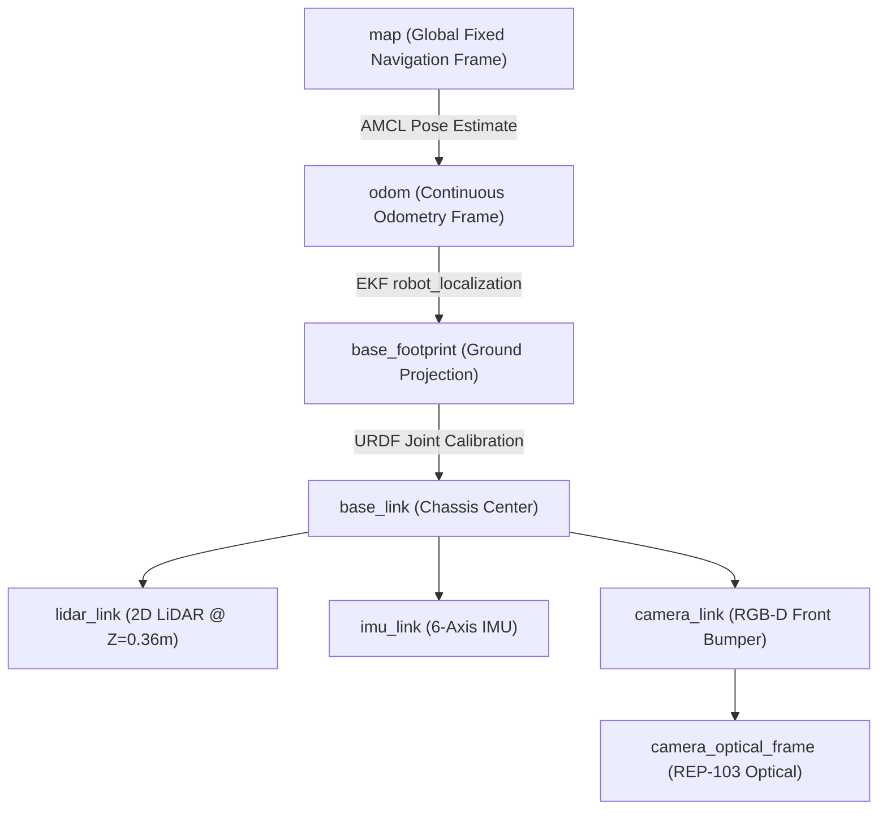
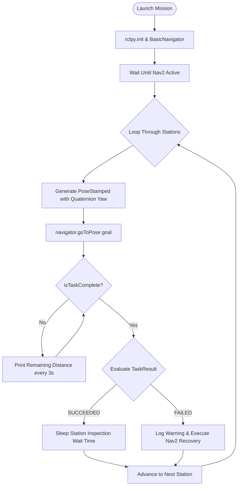

# Comprehensive Technical Documentation: Civil Architectural Mapping & Autonomous Navigation
**Project:** AgileX Scout Mini 4WD AMR Simulation  
**Platform:** ROS 2 Jazzy Jalisco & Gazebo Harmonic (`gz-sim8`) on Ubuntu 24.04 LTS  
**Reference Benchmark:** NIST Standard Indoor AGV Facility / Civil Engineering Multi-Room Floor Plan Benchmark  

---

## 1. Executive Summary & Architectural Overview

The **Civil Architectural Simulation Environment** expands the AgileX Scout Mini project from a synthetic test arena into a realistic, full-scale **Civil & Structural Engineering Research Facility** ($20.0\,\text{m} \times 16.0\,\text{m}$, total floor area $320\,\text{m}^2$). 

This environment serves two complementary robotics objectives:
1. **Civil Engineering Infrastructure Realism:** Realistic architectural zoning, reinforced concrete (RCC) structural column grids, standard $1.2\,\text{m}$ doorways, and representative facility equipment.
2. **Autonomous Navigation & Maze Circulation:** A central arterial corridor combined with interconnecting room loop doorways, forming an interconnected circulation network (maze-like topology) that tests Nav2 global path planning, local obstacle avoidance, dynamic replanning, and multi-point patrol missions.

```
+===================================================================================================+
|                                    NORTH PERIMETER WALL (20.0 m)                                  |
|  +---------------------------+  +----------------------------+  +------------------------------+  |
|  |   STRUCTURAL MATERIALS    |  |       CIVIL SEMINAR        |  |     BIM, CAD & ROBOTICS      |  |
|  |    & CONCRETE TESTING     |  |       & CONFERENCE         |  |      COMPUTING STUDIO        |  |
|  |         LABORATORY        |  |           HALL             |  |                              |  |
|  |     (Station 3: -7, 3.5)  |  |    (Station 4: 0, 3.0)     |  |     (Station 5: 7, 3.5)      |  |
|  +----- [1.2m Door] ---------+  +------ [1.4m Door] ---------+  +------- [1.2m Door] ----------+  |
|                                                                                                   |
|  <<<<<<<<<<<<<< MAIN CENTRAL ARTERIAL CORRIDOR (Width: 2.4 m, Length: 20.0 m) >>>>>>>>>>>>>>>>>   |
|  [Column @ -4m]                     (Station 2: Corridor Hub @ 0, 0)             [Column @ +4m]   |
|                                                                                                   |
|  +----- [1.2m Door] ---------+  +====== [4.0m Open Atrium] ==+  +------- [1.2m Door] ----------+  |
|  |    GEOTECHNICAL SURVEY    |  |     MAIN ENTRANCE FOYER    |  |     DEPARTMENT ARCHIVES      |  |
|  |     & SOIL MECHANICS      |  |          & ATRIUM          |  |      & EQUIPMENT VAULT       |  |
|  |        LABORATORY         |  |         (Home Base)        |  |                              |  |
|  |    (Station 7: -4.5, -5)  |  |    (Station 1: 0, -3.8)    |  |     (Station 6: 4.5, -4.8)   |  |
|  +---------------------------+  +----------------------------+  +------------------------------+  |
|                                    SOUTH PERIMETER WALL (20.0 m)                                  |
+===================================================================================================+
```

---

## 2. Facility Specifications & Spatial Geometry

### 2.1 Dimensional Parameters
| Architectural Metric | Dimension | Engineering Rationale |
| :--- | :--- | :--- |
| **Building Footprint** | $20.0\,\text{m} \times 16.0\,\text{m}$ ($X \in [-10, 10], Y \in [-8, 8]$) | Standard medium-scale institutional laboratory floor |
| **Wall Height** | $1.2\,\text{m}$ ($Z \in [0.0, 1.2]$) | Full reflection for 2D LiDAR ($Z=0.36\,\text{m}$) and RGB-D camera ($Z=0.25\,\text{m}$) while maintaining clear top-down RViz/Gazebo visualization |
| **Wall Thickness** | $0.2\,\text{m}$ ($200\,\text{mm}$) | Standard civil concrete masonry unit (CMU) partition standard |
| **Central Corridor** | $2.4\,\text{m}$ width ($Y \in [-1.2, +1.2]$) | Exceeds ADA minimum hallway width ($1.8\,\text{m}$) for multi-AMR bidirectional passage |
| **Door Openings** | $1.2\,\text{m} - 1.4\,\text{m}$ clear width | Accommodates the Scout Mini ($0.612\,\text{m}$ track width) with $>0.29\,\text{m}$ lateral safety clearance on each side |
| **Structural Columns** | $0.45\,\text{m} \times 0.45\,\text{m}$ square RCC pillars | Symmetrically spaced at $4\,\text{m}$ structural spans for LiDAR feature-based localization |

### 2.2 Zoned Functional Departments
1. **Main Entrance Foyer & Atrium ($x \in [-2.5, 2.5], y \in [-8.0, -1.2]$):**
   Welcoming reception area with a $2.6\,\text{m}$ reception counter. Features a wide $4.0\,\text{m}$ open architectural atrium connecting directly into the central corridor. Houses **Station 1 / Home Base** at $(0.0, -3.8)$.
2. **Central Arterial Corridor ($x \in [-10.0, 10.0], y \in [-1.2, 1.2]$):**
   East-west circulation artery connecting all departments. Features two cylindrical columns ($\varnothing 0.5\,\text{m}$) at $x = \pm 4.0\,\text{m}$ that act as navigation chicanes. Houses **Station 2** at $(0.0, 0.0)$ (robot default spawn).
3. **Structural Materials & Concrete Testing Lab ($x \in [-10.0, -2.5], y \in [1.2, 8.0]$):**
   Equipped with a concrete specimen testing workbench ($2.2\,\text{m} \times 0.9\,\text{m}$) and a heavy compression press base ($1.0\,\text{m} \times 1.0\,\text{m}$). Houses **Station 3** at $(-7.0, 3.5)$.
4. **Civil Seminar & Executive Conference Hall ($x \in [-2.5, 2.5], y \in [1.2, 8.0]$):**
   Meeting facility with a large central conference table ($2.4\,\text{m} \times 1.2\,\text{m}$). Houses **Station 4** at $(0.0, 3.0)$.
5. **BIM, CAD & Robotics Computing Studio ($x \in [2.5, 10.0], y \in [1.2, 8.0]$):**
   Computational design room with a central workstation island ($2.2\,\text{m} \times 0.9\,\text{m}$) and 3D printing/scanning rig ($1.0\,\text{m} \times 1.0\,\text{m}$). Houses **Station 5** at $(7.0, 3.5)$.
6. **Department Archives & Storage Vault ($x \in [2.5, 10.0], y \in [-8.0, -1.2]$):**
   Archival facility containing dual heavy-duty document and surveying instrument shelving racks ($2.0\,\text{m} \times 0.8\,\text{m}$). Houses **Station 6** at $(4.5, -4.8)$.
7. **Geotechnical Survey & Soil Mechanics Lab ($x \in [-10.0, -2.5], y \in [-8.0, -1.2]$):**
   Soil sampling inspection workbench ($2.0\,\text{m} \times 0.8\,\text{m}$) and triaxial soil shear testing rig ($1.0\,\text{m} \times 1.0\,\text{m}$). Houses **Station 7** at $(-4.5, -5.0)$.

---

## 3. Mathematical Mapping Pipeline & Generator Logic

To guarantee that simulated LiDAR rays in Gazebo match the Nav2 static costmap down to the millimeter, the world geometry and the 2D occupancy grid are generated deterministically using [`src/assem2_robot/scripts/generate_civil_world.py`](file:///home/sailakshmi/agilex/src/assem2_robot/scripts/generate_civil_world.py).

### 3.1 Coordinate Transformation Mathematics
The occupancy grid covers an extent of $22.0\,\text{m} \times 18.0\,\text{m}$ to allow margin padding around the building perimeter:
- World Bounds: $X \in [-11.0, +11.0]\,\text{m}$, $Y \in [-9.0, +9.0]\,\text{m}$
- Origin: $(X_0, Y_0) = (-11.0, -9.0)\,\text{m}$
- Map Resolution: $\Delta = 0.05\,\text{m}/\text{pixel}$ ($5\,\text{cm}$ grid cells)

Grid Dimensions in Pixels:
$$W_{\text{px}} = \frac{X_{\max} - X_{\min}}{\Delta} = \frac{11.0 - (-11.0)}{0.05} = 440\,\text{pixels}$$
$$H_{\text{px}} = \frac{Y_{\max} - Y_{\min}}{\Delta} = \frac{9.0 - (-9.0)}{0.05} = 360\,\text{pixels}$$

For any world coordinate $(x_w, y_w)$, the corresponding grid cell index $(u, v)$ with origin at bottom-left is:
$$u = \text{round}\left(\frac{x_w - X_0}{\Delta}\right), \quad v = \text{round}\left(\frac{y_w - Y_0}{\Delta}\right)$$

In image matrices (where row $0$ is the top row corresponding to $Y_{\max}$):
$$\text{Row} = (H_{\text{px}} - 1) - v, \quad \text{Col} = u$$

### 3.2 Occupancy State Encoding
Following the ROS 2 standard occupancy grid specification (`nav_msgs/msg/OccupancyGrid`):
- **Interior Free Floor Space:** Value `254` (Grayscale White $\implies$ $0\%$ obstacle probability)
- **Walls, Columns & Obstacles:** Value `0` (Grayscale Black $\implies$ $100\%$ obstacle probability)
- **Exterior Unknown Space:** Value `205` (Grayscale Light Grey $\implies$ Unknown / Unexplored)

Metadata written to [`civil_map.yaml`](file:///home/sailakshmi/agilex/src/assem2_robot/maps/civil_map.yaml):
```yaml
image: civil_map.pgm
mode: trinary
resolution: 0.0500
origin: [-11.000, -9.000, 0.000000]
negate: 0
occupied_thresh: 0.65
free_thresh: 0.25
```

---

## 4. Gazebo Harmonic 3D World (`civil_world.sdf`)

The 3D physical world is described in SDFormat 1.8 at [`src/assem2_robot/worlds/civil_world.sdf`](file:///home/sailakshmi/agilex/src/assem2_robot/worlds/civil_world.sdf).

### 4.1 Physics Engine & Plugins
```xml
<physics name="5ms" type="ignored">
  <max_step_size>0.005</max_step_size>
  <real_time_factor>1.0</real_time_factor>
</physics>

<!-- Essential Gazebo Harmonic System Plugins -->
<plugin filename="gz-sim-physics-system" name="gz::sim::systems::Physics" />
<plugin filename="gz-sim-user-commands-system" name="gz::sim::systems::UserCommands" />
<plugin filename="gz-sim-scene-broadcaster-system" name="gz::sim::systems::SceneBroadcaster" />
<plugin filename="gz-sim-sensors-system" name="gz::sim::systems::Sensors">
  <render_engine>ogre2</render_engine>
</plugin>
<plugin filename="gz-sim-imu-system" name="gz::sim::systems::Imu" />
```

### 4.2 Material Properties & Friction
- **Floor Ground Plane:** Friction coefficients $\mu_1 = 1.0, \mu_2 = 1.0$ with light slate-grey visual styling (`#D2D9E0`).
- **Walls:** Static collision boxes with drywall visual color (`#73808C`).
- **RCC Columns:** Reinforced concrete grey (`#595966`).
- **Equipment & Furniture:** Wood/metal contrast materials to provide realistic RGB-D camera point cloud color returns.

### 4.3 Robot Model Spawning
The AgileX Scout Mini AMR URDF is embedded directly:
```xml
<!-- AgileX Scout Mini AMR Robot Model Spawn (Central Corridor Hub) -->
<include>
  <uri>package://assem2_robot/urdf/Assem2.SLDASM.urdf</uri>
  <name>assem2_robot</name>
  <pose>0 0 0.02 0 0 0</pose>
</include>
```
* **Coordinate Consistency:** Spawning at $(x=0.0, y=0.0, z=0.02, \text{yaw}=0.0)$ matches the AMCL initial pose configuration in [`nav2_params.yaml`](file:///home/sailakshmi/agilex/src/assem2_robot/config/nav2_params.yaml), achieving instant localization convergence upon startup.

---

## 5. Nav2 Autonomous Navigation & Path Planning Logic

### 5.1 Coordinate Frame Tree (TF Hierarchy)


### 5.2 AMCL (Adaptive Monte Carlo Localization)
- **Motion Model:** `nav2_amcl::DifferentialMotionModel` tuned for 4WD skid-steer odometry slip:
  $\alpha_1 = 0.2, \alpha_2 = 0.2, \alpha_3 = 0.2, \alpha_4 = 0.2$.
- **Sensor Model:** Likelihood Field with 180 beams sampled per scan, max range $12.0\,\text{m}$.
- **Particle Count:** Dynamically adapts between $500$ (settled state) and $2000$ (during rapid rotation or initial recovery).

### 5.3 Costmaps & Planners
- **Global Costmap:** Uses the static layer (`civil_map.yaml`) combined with inflation radius $r_{\text{inf}} = 0.55\,\text{m}$.
- **Global Planner (`NavFn`):** Computes collision-free paths using Dijkstra's algorithm across the corridor network and through doorways.
- **Local Costmap:** $3.0\,\text{m} \times 3.0\,\text{m}$ rolling window updated at $20\,\text{Hz}$ using live LiDAR `/scan` obstacle observation layers.
- **Local Controller (`DWBLocalPlanner`):** Trajectory generator evaluating forward candidate trajectories against PathAlign, GoalAlign, and BaseObstacle critics to output skid-steer linear $v_x$ and angular $\omega_z$ commands on `/cmd_vel`.

---

## 6. Autonomous Multi-Room Patrol Mission (`civil_patrol_mission.py`)

The mission node at [`src/assem2_robot/scripts/civil_patrol_mission.py`](file:///home/sailakshmi/agilex/src/assem2_robot/scripts/civil_patrol_mission.py) uses the ROS 2 `nav2_simple_commander` API.

### 6.1 Patrol Station Specifications
```python
stations = [
    {"name": "Station 1: Entrance Foyer & Atrium (Home)", "x":  0.0, "y": -3.8, "yaw":  90.0, "wait": 3.0},
    {"name": "Station 2: Central Corridor Hub",           "x":  0.0, "y":  0.0, "yaw":   0.0, "wait": 2.0},
    {"name": "Station 3: Structural Materials Lab",       "x": -7.0, "y":  3.5, "yaw":  90.0, "wait": 4.0},
    {"name": "Station 4: Conference Hall",                "x":  0.0, "y":  3.0, "yaw":  90.0, "wait": 3.0},
    {"name": "Station 5: CAD & Robotics Studio",          "x":  7.0, "y":  3.5, "yaw":  90.0, "wait": 4.0},
    {"name": "Station 6: Archives Vault",                 "x":  4.5, "y": -4.8, "yaw":   0.0, "wait": 3.0},
    {"name": "Station 7: Geotechnical Survey Lab",        "x": -4.5, "y": -5.0, "yaw": 180.0, "wait": 4.0},
]
```

### 6.2 Execution Logic Flow


---

## 7. Launch Architecture & File Separation

To ensure zero risk to baseline configurations, the launch architecture is structured with clean separation:

| Launcher | File Path | Environment | Purpose |
| :--- | :--- | :--- | :--- |
| **Normal Launcher** | [`src/assem2_robot/launch/simulation.launch.py`](file:///home/sailakshmi/agilex/src/assem2_robot/launch/simulation.launch.py) | $10\,\text{m} \times 10\,\text{m}$ Obstacle Arena (`amr_world.sdf`) | Baseline test environment with EKF & teleoperation |
| **Normal Backup** | [`src/assem2_robot/launch/simulation.launch.py.backup`](file:///home/sailakshmi/agilex/src/assem2_robot/launch/simulation.launch.py.backup) | $10\,\text{m} \times 10\,\text{m}$ Obstacle Arena (`amr_world.sdf`) | Byte-for-byte duplicate backup of original launcher |
| **Civil Launcher** | [`src/assem2_robot/launch/civil_simulation.launch.py`](file:///home/sailakshmi/agilex/src/assem2_robot/launch/civil_simulation.launch.py) | $20\,\text{m} \times 16\,\text{m}$ Civil Multi-Room Facility (`civil_world.sdf`) | New architectural civil world with `civil_map.yaml` & Nav2 |

---

## 8. Complete Command Execution Manual

### 8.1 Build & Environment Sourcing
```bash
cd ~/agilex
source /opt/ros/jazzy/setup.bash
colcon build --symlink-install
source install/setup.bash
```

### 8.2 Launching the Civil Environment
```bash
# Terminal 1: Starts Gazebo Harmonic, Robot State Publisher, ROS Bridge, RViz2, EKF & Nav2 Stack
ros2 launch assem2_robot civil_simulation.launch.py use_nav:=true
```

### 8.3 Running Autonomous Patrol
```bash
# Terminal 2: Starts multi-room autonomous waypoint traversal
cd ~/agilex
source install/setup.bash
ros2 run assem2_robot civil_patrol_mission
```

### 8.4 Manual Navigation (RViz2)
1. In the RViz2 window, select the **`2D Goal Pose`** tool on the top toolbar (hotkey <kbd>G</kbd>).
2. Click any room floor and drag the arrow in the desired final orientation.
3. The robot will plan paths through the central corridor and doorways to arrive at the target.

### 8.5 Running the Normal Simulation (Original 10x10 Arena)
```bash
# Launches the original obstacle arena
ros2 launch assem2_robot simulation.launch.py
```
